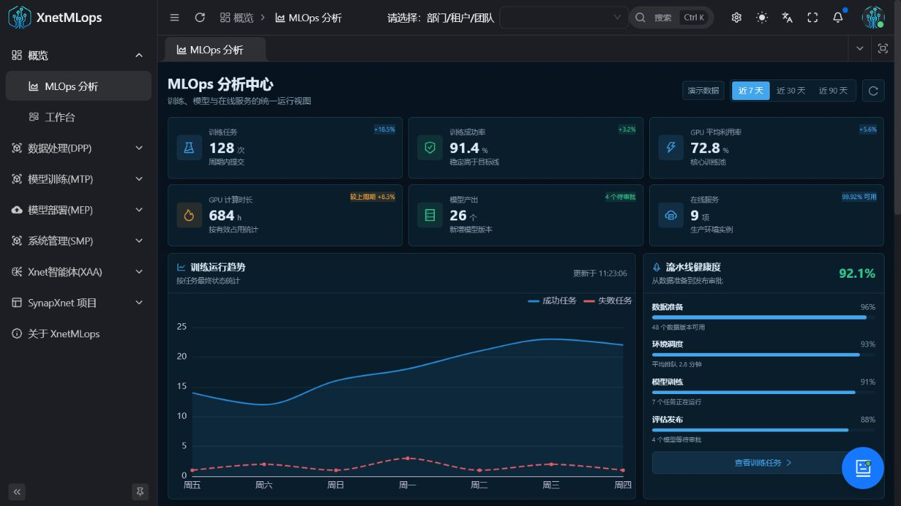
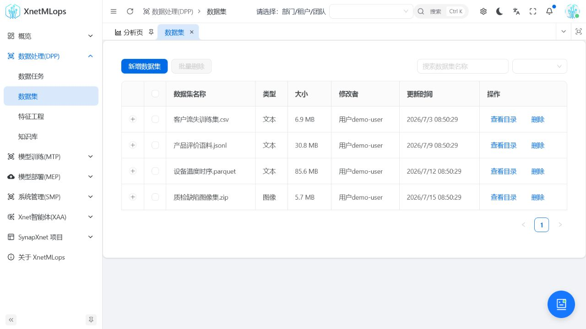
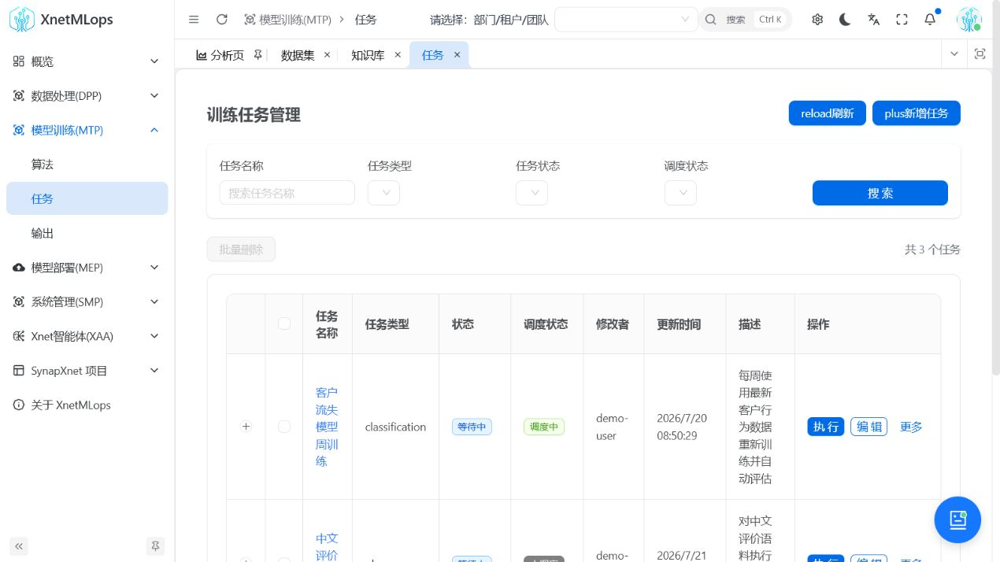
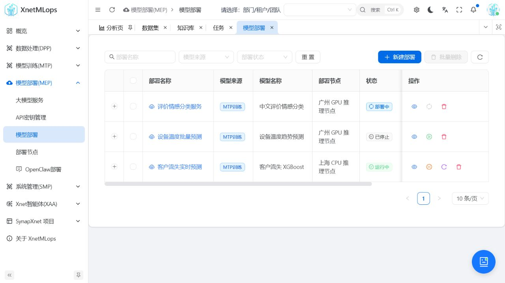
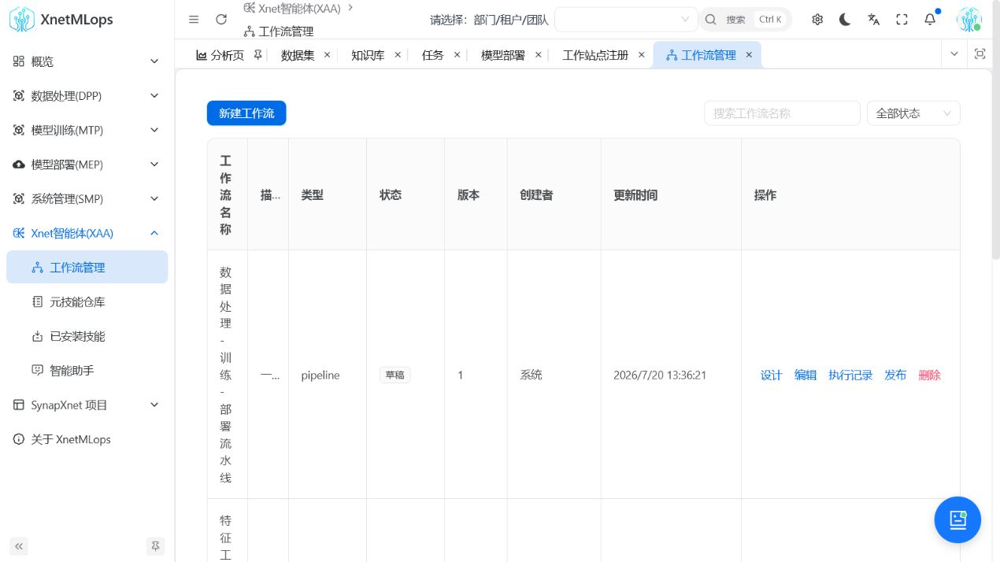

<!-- Copyright (C) 2026 Synapxnet. All rights reserved.
Author: maoyo | Department: 研发部 | Date: 2026-10-23 | Version: 1.0.0 | Security Level: INTERNAL -->

**简体中文** · [English](./README.en-US.md) · [日本語](./README.ja-JP.md)

# XnetMLops

连接数据准备、模型训练、部署服务、基础资源和智能体协作的 MLOps 平台。本仓库提供后端微服务；配套 Web 控制台可独立构建和部署。

[配套仓库](https://github.com/synapxnet/XnetMLops-web/tree/main) · [历史发行](https://github.com/synapxnet/XnetMLops/releases) · [SynapXnet 社区](https://openxnet.synapxnet.com)

当前开发主线为 main。平台保留驻场 Agent、Skill、模型证据、跨域恢复、人工审批、独立验证、幂等控制与回滚能力。运行环境、平台地址和企业身份由部署配置提供。

## 功能模块

| 模块 | 能力 |
| --- | --- |
| DPP 数据处理 | 数据集、预处理、特征工程、数据产品导入、RAG 知识库 |
| MTP 模型训练 | 算法、即时与定时训练、日志、模型产物和证据 |
| MEP 模型部署 | 模型与 LLM 服务、API 密钥、部署节点、受控发布与回滚 |
| SMP 系统管理 | 租户、部门、团队、数据源、存储和计算资源 |
| XAA 智能体 | 助手、会话、可视化工作流、Skill 管理与导入 |
| 驻场协作 | 平台状态、知识与能力工作台、跨平台任务及证据关联 |

## 界面预览

以下为功能界面示例；业务记录和运行状态由所连接的环境提供。

| DPP | MTP |
| --- | --- |
|  |  |
| MEP | XAA |
|  |  |

## 开发与构建

使用 JDK 17、Maven 3.9+、MySQL 8.x 和 Redis。按所启用的业务模块配置 HDFS、Jenkins、对象存储、模型计算与推理服务。

~~~bash
git clone --branch main https://github.com/synapxnet/XnetMLops.git
cd XnetMLops
mvn -B -ntp -DskipTests package
~~~

将 .env.example 复制为本地 .env，配置数据库、Redis、JWT、存储、审批服务和平台委派身份。先构建配套前端，WEB_DIST_PATH 指向其 apps/web-antd/dist。现有数据库使用经审阅的迁移脚本；XnetMLops.sql 是初始化脚本。完成网关配置后运行 docker compose config --quiet，再启动所需服务。

## 部署配置

登录使用企业手机号与短信网关签发的一次性验证码。后端配置 XNET_SMS_GATEWAY_URL 和 XNET_SMS_GATEWAY_TOKEN；未配置时发送服务明确不可用。验证码五分钟有效、限频发送、限制错误次数，成功验证后消费。

驻场 Agent 运行时作为独立平台服务接入 /api/resident/v1，需配置平台身份、模型服务及委派权限。助手、驻场运行时和跨平台协作保留各自职责。组织树按已认证用户的成员关系过滤，业务请求继续受租户、团队与审批边界约束。

模型运行时地址、令牌、部署 UID 和探针由环境配置。OPENXNET_MODEL_RESOURCE_BINDINGS 与 OPENXNET_FEATURE_DRIFT_RESOURCE_IDS 明确可操作资源；实际状态必须由运行时回读。OPENXNET_REHEARSAL_ENABLED 默认 false，生产流程不会自动填入合成演练结果。

## API 与网关

配套前端默认使用以下同源 API 前缀。nginx/default.conf 已匹配实际 Controller 路径；使用官方 Nginx 入口模板，根据部署设置 XNET_*_UPSTREAM 上游地址。

| 服务 | 前端 API 前缀 | 后端内部端口 |
| --- | --- | --- |
| Auth | /api | 8181 |
| DPP | /dpp | 8182 |
| MTP | /mtp | 8183 |
| MEP | /mep | 8184 |
| SMP | /smp | 8185 |
| XAA | /xaa | 8186 |

## 文档与贡献

欢迎通过 Issue 与 Pull Request 提交改进。接口或数据结构变更应附带契约、权限和迁移说明。历史发行保留在 GitHub Releases，当前开发文档与主线代码同步维护。

- [Mainline configuration and migration](./docs/mainline/transition.md)
- [DPP](./docs/DPP-Knowledge-Base.md) · [MTP](./docs/MTP-Knowledge-Base.md) · [MEP](./docs/MEP-Knowledge-Base.md) · [SMP](./docs/SMP-Knowledge-Base.md) · [XAA](./docs/XAA-Knowledge-Base.md)

## 许可

请遵守仓库 LICENSE 及各文件的版权声明。前端使用 Vue Vben Admin，并保留其上游许可。 [LICENSE](./LICENSE)
## 数据库与网关初始化

新建数据库依次执行 `XnetMLops.sql` 和 `database/mainline-capabilities.sql`。后者补齐知识库、特征算子、工作站、Jenkins、Hadoop、助手、Skill、工作流与治理审计结构，支持重复执行，不导入演示节点、工作流或运行数据。已有数据库先备份，再执行能力结构脚本；组织成员的 `data_access_enabled` 默认为 0，按实际团队显式授权。

Compose 挂载 Nginx 模板，启动时注入各服务上游地址。前端与后端网关模板保持同一契约：`/api/` → 登录原路径，`/dpp/`、`/mtp/`、`/smp/` → 对应服务 `/api/`，`/mep/` → MEP 原路径，`/xaa/` → `/api/xaa/`。普通业务接口均先做组织权限校验；Agent 工具保留委派令牌校验。公开入口仅为网关，后端端口默认绑定本机回环地址。Kubernetes 同样只发布网页网关 Ingress。

独立驻场服务通过 `XNET_RESIDENT_AGENT_URL` 配置（完整协议与地址，不带末尾斜杠），未配置时驻场页明确显示服务不可用。域名解析使用 `XNET_DNS_RESOLVER`，Docker 默认 `127.0.0.11`，Kubernetes 应设置集群 DNS 地址。

知识库管理和已有记录可用；当前内置后端尚无文档处理与向量检索执行器，上传、重建和检索返回明确不可用状态。LLM 服务的启用/停用控制连接配置，外部服务健康由连接测试核验。训练、HDFS、Jenkins 和驻场执行需要连接实际依赖，未配置时不会生成成功结果。

Kubernetes 清单使用 `xnet-mlops` 命名空间、`xnet-mlops-runtime` ConfigMap 和 `xnet-mlops-secrets` Secret。先调整 `deploy/runtime-config.example.yaml` 中的依赖主机并应用配置；Secret 至少需要 `DB_PASSWORD`、`JWT_SECRET`，短信及委派令牌按启用能力添加。不要把密钥写入 ConfigMap。镜像地址与拉取凭据应改为自己的镜像仓库。服务名、端口与前端网关已配套；MEP/XAA 分别使用 8184/8186。

真实特征漂移运行时使用令牌文件时，Compose 叠加 `deploy/compose.feature-drift.example.yaml` 并设置宿主文件路径；Kubernetes 使用 `deploy/feature-drift-secret.patch.example.yaml` 的 Secret 只读挂载示例。仅设置容器内路径不会传入文件。启用 Kubernetes 驻场域名时，在 `xnet-mlops-runtime` 同时设置 `XNET_RESIDENT_AGENT_URL` 和集群 `XNET_DNS_RESOLVER`。
